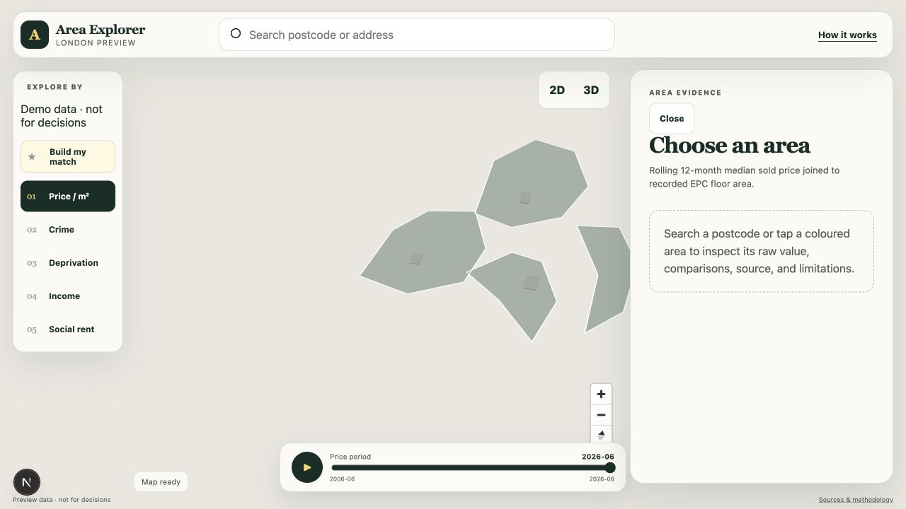
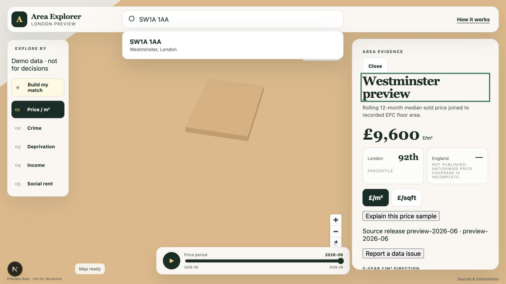
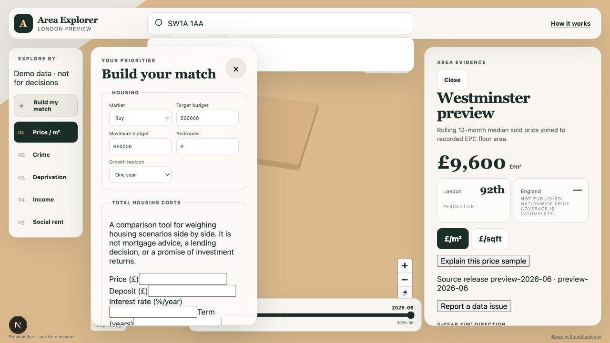
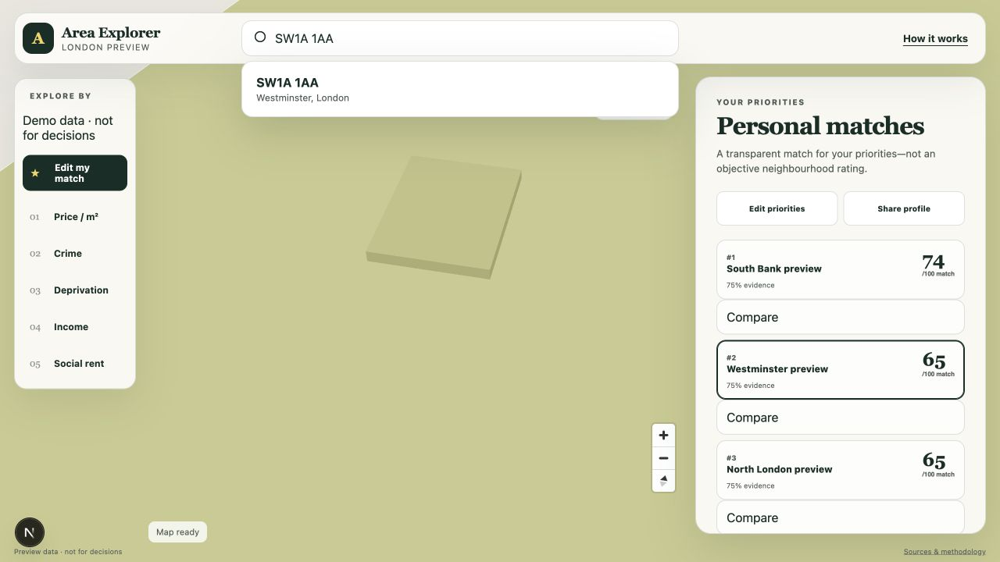
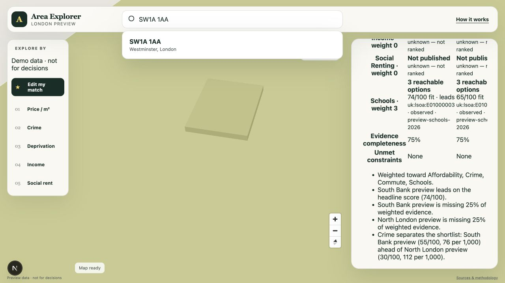
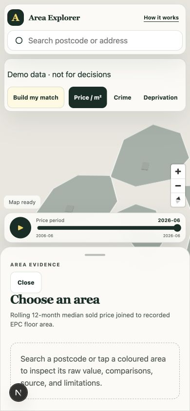
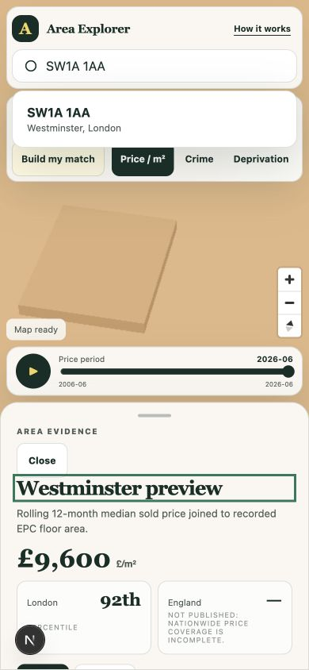
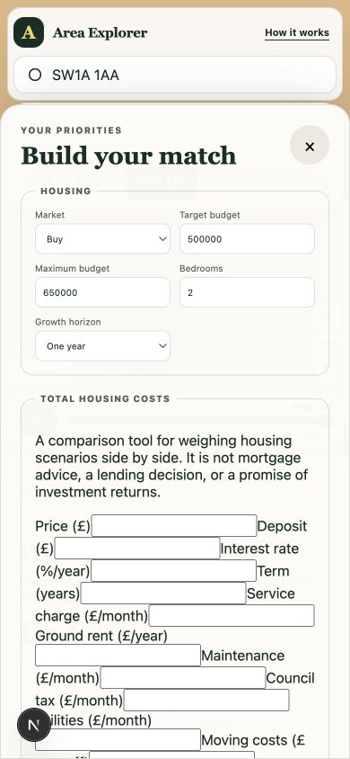
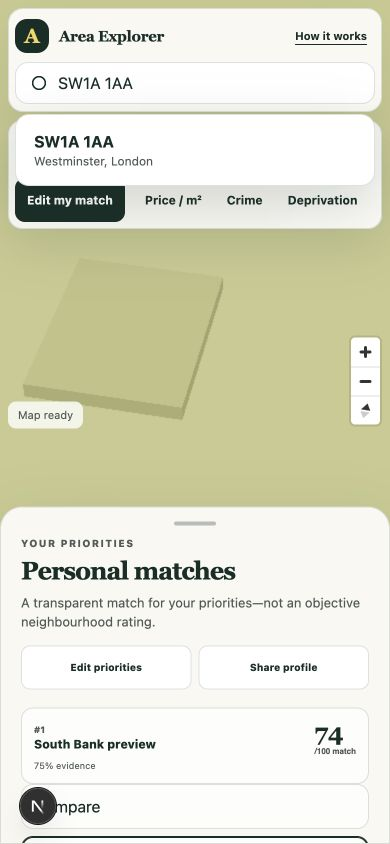
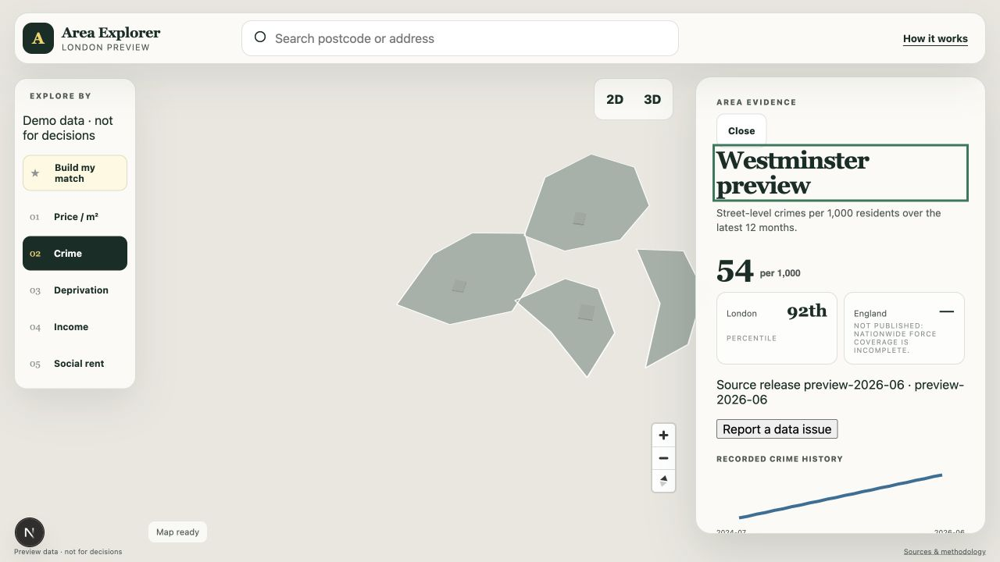

# Close Knit product and UX audit

Audited locally on 6 September 2026 from `main` at `51da574` (merged PR #84). The review covered the primary desktop and mobile journeys, keyboard operation, data-mode behaviour, and the Playwright browser suite.

Collaborative board: [Close Knit — Product & UX Audit](https://www.figma.com/board/IXZ3o3iQvyYuyO3neIj0Hz)

## Verdict

Close Knit has a coherent and distinctive visual foundation, but the current product is not release-ready. The start screen and ranked-match cards look polished; the core decision journey becomes unclear and, in places, unusable. The most serious problem is one of trust: a URL that requests real data can silently render preview evidence. The preference form and area comparison also break at the widths where they are presented.

| Dimension | Score | Assessment |
| --- | ---: | --- |
| Visual design | 7.5/10 | Strong palette, typography, hierarchy, and consistent card language. |
| Task clarity | 4/10 | The product combines discovery, preferences, due diligence, and decision export without a clear staged journey. |
| Responsive UX | 3.5/10 | The map shell reflows well, but key forms, tables, and controls collide or clip. |
| Accessibility | 6/10 | Useful semantics, focus styling, keyboard search, and a skip link; very large dialogs and ambiguous names remain. |
| Data trust | 3/10 | Source metadata is unusually good, but real/demo mode is not enforced end to end. |
| Overall | 4.8/10 | A promising, visually credible prototype with release-blocking correctness and usability defects. |

## Audited journey

### 1. Start and orient — healthy foundation

The opening view is calm and legible. The warm neutral map, dark green controls, yellow accent, serif headings, and restrained shadows form a coherent visual system. Search, map layers, and evidence have obvious regions. The map itself is too abstract to support real housing decisions: sparse fixture polygons and missing place labels make it feel like a demo surface rather than a navigable London map.

### 2. Search and select an area — works, then reopens

Keyboard search works and moves focus to the selected area. After selection, the suggestion list reappears and obscures the map because the selected label is written back into the query and immediately searched again. The state transition is implemented in [`explorer-header.tsx`](../../web/src/components/explorer-header.tsx#L76). The dropdown needs a committed-selection state and outside-click or blur dismissal.

### 3. Read area evidence — visually strong, structurally overloaded

The selected-area summary, headline value, London and England comparators, unit control, source release, and methodology links are clear. This is the strongest product surface. The same 372px panel then stacks price history, flood, noise, planning, property history, viewing checks, and candidate capture into a very long feed. Users need a summary first and progressive disclosure into named evidence sections. The percentile suffix is generated as `${value}th`, producing text such as “92th”; see [`evidence-panel.tsx`](../../web/src/components/evidence-panel.tsx#L230).

### 4. Define preferences — broken and too broad

The 350px panel cannot contain the total-cost worksheet: labels and fields overlap and clip. It also asks for housing, finance, leasehold, factor weights, schools, commutes, amenities, consent, and destructive profile controls in one scroll. The preference surface is 355 lines and mounts all of those modules together in [`preference-panel.tsx`](../../web/src/components/preference-panel.tsx#L91). Split this into a short first-run match setup, followed by optional refinements and property-level diligence.

### 5. Review ranked matches — mostly healthy

The three ranked cards communicate order, score, evidence completeness, and area identity well. Edit and share actions are easy to find. “Compare” is detached as a full row beneath each card, so the relationship between selection and comparison is weaker than it should be. Place the comparison control inside each result card and show a persistent comparison tray once two areas are selected.

### 6. Compare areas — broken at its intended width

The side-by-side table is rendered inside the narrow right panel and is horizontally clipped. Area columns and row labels cannot be read together, and scrolling can land users midway through the table without its header. Comparison is a primary decision task and needs a full-width modal, dedicated route, or bottom sheet that can preserve row labels and area headers.

### 7. Start on mobile — good reflow with hidden choices

The header, search, layer strip, map, and evidence sheet reflow into a credible mobile composition. The layer strip overflows horizontally but provides no strong scroll cue, leaving later layers hidden. The default evidence sheet occupies about 40% of the viewport before an area is chosen, reducing the useful map without delivering evidence.

### 8. Read evidence on mobile — functional but crowded

The area title and primary figures remain readable. The reopened search dropdown consumes a large part of the map, and the evidence sheet turns the same long desktop feed into an even longer mobile task. A summary/detail split is needed here as well.

### 9. Define preferences on mobile — unusable

The cost fields overlap and clip more severely on mobile. The full-height dialog exposes the same excessive scope and sends the primary “Show my matches” action far below the first viewport. The responsive rule only expands the panel to full width; it does not change the form layout or product sequence. See [`globals.css`](../../web/src/app/globals.css#L252).

### 10. Review matches on mobile — strong card, control collision

The ranked result card remains clear, but the MapLibre compass overlaps the comparison row at the lower left of the sheet. The fixed map-control offsets in [`globals.css`](../../web/src/app/globals.css#L268) assume the sheet boundary rather than protecting interactive content inside it.

### 11. Request real data — critical trust failure

The audited URL requested `mode=real&release=official-2026-06`; the UI rendered “Demo data · not for decisions,” Westminster preview values, and source release `preview-2026-06`. The evidence network request omitted both mode and release. [`close-knit.tsx`](../../web/src/components/close-knit.tsx#L15) passes mode and release to personal matches, but not to the layer picker or evidence panel; its footer is also permanently preview-labelled. Real/demo mode must be visible and enforced at every request boundary. If the selected source is unavailable in real mode, show an explicit unavailable state instead of falling back.

## Priority fixes

### P0 — required before release

1. Enforce `mode` and `release` end to end for layers, evidence, matching, saved state, and footer labels. Add a browser regression test that asserts a real-mode request never contains a preview release and never renders fixture evidence.
2. Redesign the preference flow as staged steps and repair every field layout at desktop and mobile widths. Keep the initial match setup to housing needs, budget, and a small set of priorities; move total-cost and leasehold tools into property diligence.
3. Move comparison out of the 372px evidence panel and verify two, three, and four-area tables at desktop and mobile widths.
4. Close search suggestions when a result is committed; do not refetch the committed label until the user edits it.
5. Resolve the mobile map-control collision and run visual regression checks for every bottom-sheet state.
6. Bring the browser suite back to green or update assertions where the product contract intentionally changed. The current run stopped after 12 failures; real regressions include search selection and missing rendering diagnostics, while several failures are stale fixtures, stale copy, or ambiguous test locators.

### P1 — make the decision journey clear

1. Define a visible sequence: discover areas, set needs, shortlist, compare, inspect evidence, then prepare a decision brief. Preserve context and progress between these stages.
2. Give evidence a concise overview plus expandable sections for price, flood, noise, planning, schools, commute, and provenance. Keep property-specific checks out of area-level evidence until a property is selected.
3. Put compare selection inside each match card and show a persistent tray with selected areas and a clear “Compare areas” action.
4. Add familiar geographic context to the map: place labels, boundaries, selected-area emphasis, and a clearer explanation of what the coloured shapes represent.
5. Clarify evidence-panel close and reopen behaviour on desktop and use a collapsed sheet state on mobile before an area is selected.

### P2 — polish and accessibility

1. Format ordinal numbers correctly (`1st`, `2nd`, `3rd`, `4th`), improve unit and geography labels, and remove duplicated or ambiguous accessible names such as “Price unit.”
2. Add a visible overflow cue to the mobile layer strip and preserve the active layer in view.
3. Test with a real screen reader and measure contrast. The audit confirmed keyboard search, native controls, focus styling, reduced-motion support, and the skip link, but it did not establish WCAG conformance.

## Verification evidence

- Web unit suite: 275 passed.
- API suite: 135 passed, 9 skipped.
- Type checking and production build passed.
- Playwright: 144 tests discovered; the run stopped at the configured limit after 12 failures. The failures were inspected before the isolated audit worktree was removed.
- Desktop and mobile flows were operated in the browser, including search, layer changes, evidence selection, preference entry, matching, comparison, responsive reflow, and a real-mode deep link.

The audit used the local fixture experience and one real-mode deep-link check. It did not exercise a production data deployment, live network conditions, external source links, screen-reader software, or measured colour contrast.
